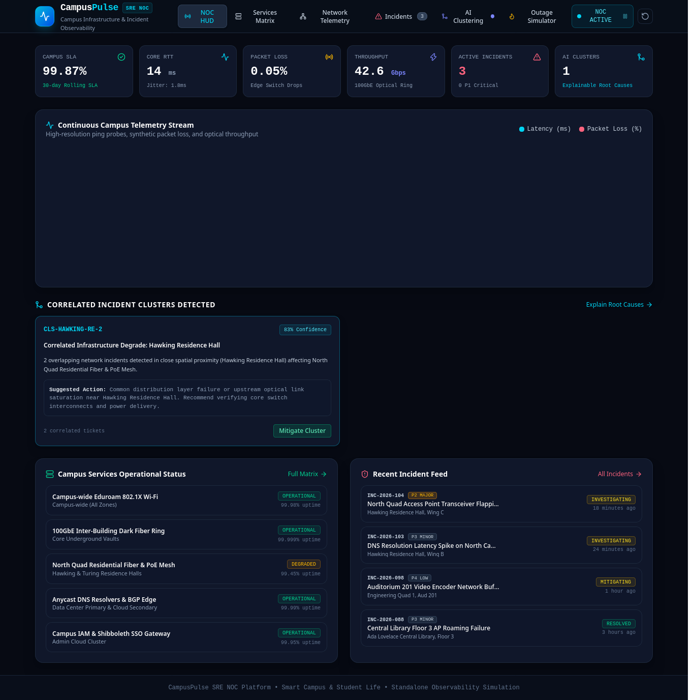

# CampusPulse — Campus Infrastructure & SRE Incident Observability Platform

[](https://react.dev)
[](https://www.typescriptlang.org/)
[](https://vitejs.dev/)
[](https://tailwindcss.com/)
[](https://vitest.dev/)

**CampusPulse** is an enterprise-grade Site Reliability Engineering (SRE) and Network Operations Center (NOC) observability platform for university digital infrastructure. It pairs continuous synthetic network telemetry (latency, jitter, packet loss, optical throughput) with explainable client-side incident clustering and interactive chaos engineering simulation.

---

## Dashboard Preview



---

## 1. Problem Statement

Modern university campuses run complex distributed infrastructure spanning residential mesh networks, lecture hall AV distribution, identity providers, and high-performance research computing grids. When disruptions occur:

- **Siloed Alarms:** Helpdesks receive disparate complaints from multiple dorms and departments without immediate awareness of a common root failure.
- **Root Cause Latency:** Engineers lose critical time triaging isolated symptoms rather than pinpointing upstream optical switch cuts or DNS amplifier floods.
- **Informal Communication:** Status updates remain fragmented across email lists and group chats, preventing students from understanding true service health.

---

## 2. Core Capabilities

### A. Real-time SRE Network Operations HUD
- Real-time synthetic probe telemetry tracking **Core Round-Trip Latency (RTT)**, **Jitter**, **Edge Packet Loss (%)**, and **100GbE Optical Throughput (Gbps)**.
- Dual-axis interactive area/line charts powered by **Recharts**.
- Live campus-wide rolling **SLA Uptime Calculation** (99.98% target).

### B. Core Campus Services Matrix
- Comprehensive health matrix monitoring 8 foundational campus systems:
  1. **Campus-wide Eduroam 802.1X Wi-Fi**
  2. **100GbE Inter-Building Dark Fiber Ring**
  3. **North Quad Residential Fiber & PoE Mesh**
  4. **Anycast DNS Resolvers & BGP Edge**
  5. **Campus IAM & Shibboleth SSO Gateway**
  6. **Library High-Density Study LAN & APs**
  7. **Lecture Hall AV & Hybrid Streaming Feeds**
  8. **Science Research InfiniBand Fabric**
- Live SLA tracking, latency measurements, and direct incident linkages.

### C. Explainable Incident Clustering Engine
- Transparent client-side clustering algorithm that correlates independent incident tickets into systemic root causes:
  $$\text{Similarity}(A, B) = 0.35 \times \text{Spatial} + 0.30 \times \text{Temporal} + 0.25 \times \text{ServiceGraph} + 0.10 \times \text{Category}$$
- Threshold $\ge 0.55$ automatically forms an incident cluster with human-readable rationale, confidence scoring, and 1-click batch mitigation.

### D. SRE Incident Lifecycle & Audit Timeline
- Comprehensive ticket triage: Severity levels (`P1 Critical`, `P2 Major`, `P3 Minor`, `P4 Low`).
- Interactive status stepper: `Investigating` $\rightarrow$ `Identified` $\rightarrow$ `Mitigating` $\rightarrow$ `Resolved`.
- Chronological engineering timeline with author attribution and resolution root cause documentation.

### E. Chaos Outage Simulation Studio
- Three realistic chaos disruption scenarios:
  - **North Quad Excavation Fiber Sever:** Cuts primary optical trunk, spikes latency by +120ms, elevates loss by +18.5%.
  - **Recursive DNS Amplification Flood:** Floods Anycast resolvers with 2.8M QPS, degrading internal domain name resolution.
  - **Library Hub Switch Thermal Overheat:** HVAC closet failure causing core switch clock throttling.
- Observe real-time telemetry degradation and automated cluster detection.

### F. Local Persistence & Clean Demo Reset
- All scenario state overrides, custom incidents, and resolution notes persist across reloads via `localStorage`.
- **Reset Demo Data:** Restores nominal baseline state with full confirmation safeguard.

---

## 3. Architecture & File Structure

```text
campuspulse/
├── src/
│   ├── components/
│   │   ├── clustering/
│   │   │   └── ClusteringView.tsx       # Explainable root-cause grouping
│   │   ├── dashboard/
│   │   │   └── OverviewView.tsx         # Primary SRE NOC overview HUD
│   │   ├── incidents/
│   │   │   ├── IncidentDetailModal.tsx  # Lifecycle stepper & timeline logger
│   │   │   └── IncidentFeed.tsx         # Filterable ticket triage feed
│   │   ├── layout/
│   │   │   └── Navbar.tsx               # Navigation HUD & simulation controls
│   │   ├── network/
│   │   │   └── NetworkAnalytics.tsx     # High-density RTT & loss graphs
│   │   ├── scenarios/
│   │   │   └── ScenarioStudio.tsx       # Interactive chaos outage injector
│   │   └── services/
│   │       └── ServiceMatrix.tsx        # 8-service campus reliability matrix
│   ├── data/
│   │   └── seedData.ts                  # Seeded services, tickets & scenarios
│   ├── engine/
│   │   ├── clustering.ts                # Deterministic similarity algorithm
│   │   ├── clustering.test.ts           # Vitest unit test suite
│   │   └── telemetry.ts                 # Dynamic synthetic probe engine
│   ├── store/
│   │   └── useCampusPulseStore.ts       # Zustand store + localStorage
│   ├── types/
│   │   └── index.ts                     # Strict TypeScript definitions
│   ├── App.tsx
│   ├── main.tsx
│   └── index.css
├── docs/
│   └── screenshots/
│       └── dashboard.png
├── package.json
├── vite.config.ts
├── tsconfig.json
└── README.md
```

---

## 4. Setup & Running Locally

```bash
# Clone and enter directory
cd campuspulse

# Install dependencies
pnpm install

# Run development server
pnpm dev

# Run Vitest test suite
pnpm test

# Build for production
pnpm build
```

---

## 5. Verification & Testing

Unit tests in `src/engine/clustering.test.ts` verify:
1. High similarity scores ($\ge 0.70$) for incidents with overlapping locations and temporal proximity.
2. Low similarity scores for disparate incidents.
3. Accurate grouping into explainable root clusters.
4. Telemetry engine correctly spikes latency and packet loss under active chaos outage scenarios.
